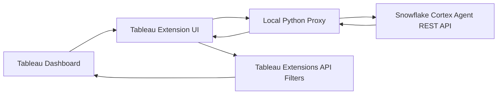

# Architecture

This project embeds a small web app inside Tableau using the Tableau Extensions API.

## Request Flow

1. The user asks a Formula 1 question in the embedded extension.
2. `extension/app.js` sends the prompt and dashboard worksheet names to the local proxy.
3. `proxy/proxy_server.py` calls the Snowflake Cortex Agent `:run` endpoint.
4. The agent returns a concise answer and filter JSON.
5. The extension displays the answer and applies each filter to compatible worksheets.

## Why The Proxy Exists

The Tableau extension runs in the browser. Snowflake credentials must not be placed in browser code, the `.trex` manifest, or any static file served to users.

The proxy reads credentials from `.env`, calls Snowflake server-side, and returns only the safe response needed by the extension.
